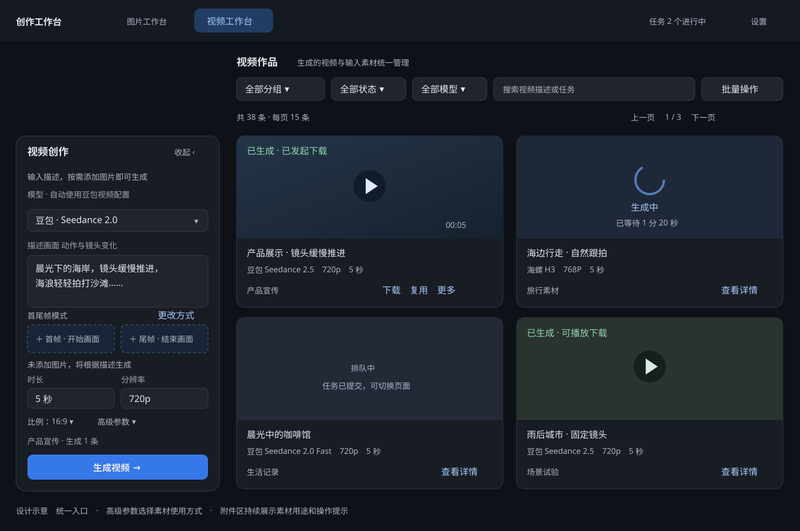
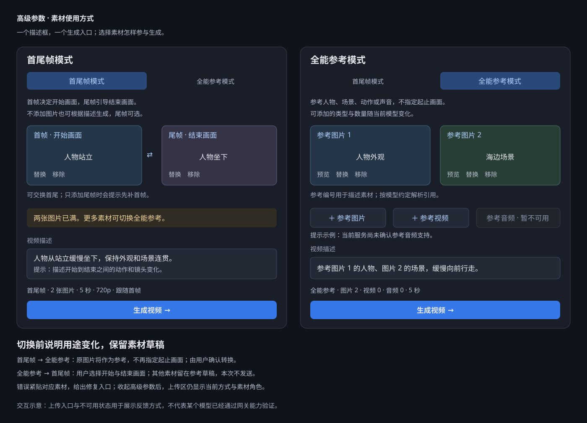
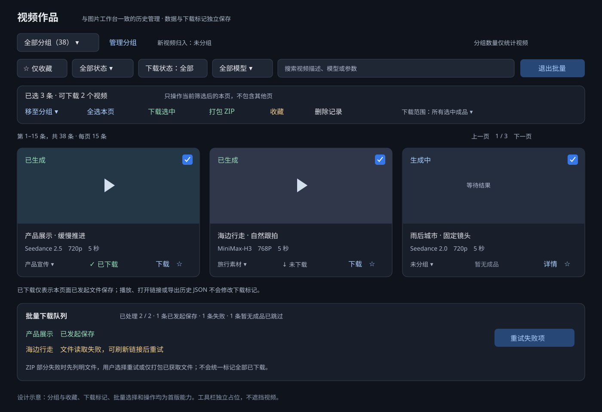
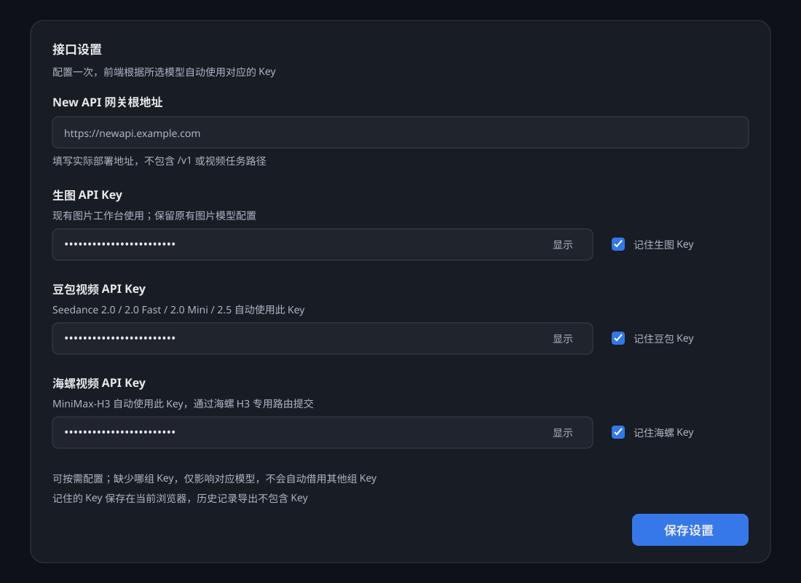
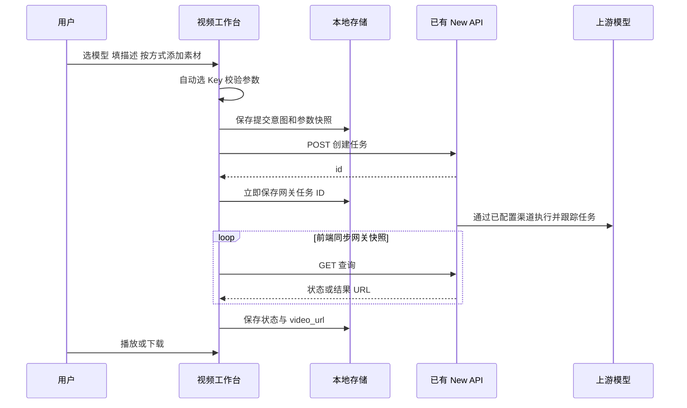
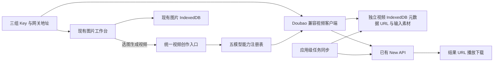
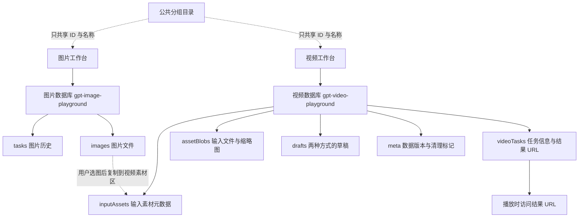

# 图片与视频生成工作台设计方案

**接口实现修订**：当前实现已按服务分别配置路由与响应协议。豆包保留 `/doubao/api/v3/contents/generations/tasks`；MiniMax-H3 默认使用 `/hailuo/v2/video_generation` 和 `/hailuo/v2/query/video_generation/{task_id}`，解析 `task_id`、`task.content.url`。设置可修改相对路径，旧任务保留提交路由，失败快捷重试使用最新配置且不覆盖草稿。下文早期“海螺也走 Doubao”的约定已被此修订替代；当前操作与接口以[使用说明](video-workbench-usage.md)为准。

版本：V1.5

日期：2026 年 11 月 2 日

适用项目：gpt_image_playground

用途：页面设计、New API 接入约定与后续开发依据

交付范围：设计文档与页面示意，尚未开发视频功能

后续界面统一规划见 [图片与视频工作台界面统一规划](workspace-ui-consistency-plan.md)。其中的面板头部、作品工具栏、批量栏和分页规范作为这两部分界面后续调整的统一依据。

## 1 已确定的方案

在现有应用内增加视频工作台，顶部提供“图片 / 视频”切换。视频创作只有一个入口：**选择模型，输入描述，按需添加素材，点击生成视频。** 不设置“文生视频 / 图生视频”切换按钮。高级参数增加“素材使用方式”：**首尾帧模式 / 全能参考模式**，决定素材用途，不增加独立页面或生成入口。默认首尾帧模式，无素材时仍可直接按描述生成。

后端沿用现有 **New API**，豆包和海螺视频统一使用 **Doubao 兼容格式**：

- 创建：`POST /doubao/api/v3/contents/generations/tasks`
- 查询：`GET /doubao/api/v3/contents/generations/tasks/{task_id}`
- 成功结果：读取 `content.video_url`，用于播放、下载及记录历史。

设置页分别配置 **生图 Key、豆包视频 Key、海螺视频 Key**。前端通过模型注册表自动选择对应视频 Key，不要求用户每次选择服务商或凭证。

视频模型仅包含以下五项：

| 页面显示名称 | 请求中的完整 model 值 | 自动使用的 Key |
| --- | --- | --- |
| 豆包 Seedance 2.0 | `doubao-seedance-2-0-260128` | 豆包视频 Key |
| 豆包 Seedance 2.0 Fast | `doubao-seedance-2-0-fast-260128` | 豆包视频 Key |
| 豆包 Seedance 2.0 Mini | `doubao-seedance-2-0-mini-260615` | 豆包视频 Key |
| 豆包 Seedance 2.5 | `doubao-seedance-2-5-260628` | 豆包视频 Key |
| 海螺 H3 | `MiniMax-H3` | 海螺视频 Key |

前端不直接连接火山方舟或 MiniMax 官方域名，不新增三套厂商接口适配器，也不新增 Node.js、SQLite 或后台任务调度服务。上游渠道、模型映射、凭证转换及任务跟踪由已有 New API 负责；前端负责输入、参数校验、提交、查询网关快照和作品展示。

**存储采用图片与视频独立数据库。** 现有图片继续使用 `gpt-image-playground`；视频新建 `gpt-video-playground`，默认只持久化生成任务、结果 URL、素材用途和草稿，不下载生成视频本体。用户上传的输入素材与必要缩略图保存在视频库自己的素材区，避免删除图片记录时破坏视频草稿。保存链接不等于保存永久视频文件，详见第 8 节。

**视频工作台首版同时具备图片工作台的作品管理能力**：分组管理、收藏、已下载 / 未下载标记、搜索与筛选、分页、批量选择、批量移动分组、批量收藏、批量删除、批量下载与 ZIP 打包、参数复用和独立备份。视频不是只有生成和播放的简化页面；批量下载纳入本次设计，不再作为后续扩展。

### 1.1 依据与边界

已核对用户提供的 [New API Doubao 查询任务文档](https://apifox.newapi.ai/525593886e0)：使用网关 Bearer 令牌，查询返回当前用户的任务快照，上游状态由后台轮询更新；完成示例包含 `status: succeeded` 和 `content.video_url`。

“海螺也走 Doubao 兼容入口”是本项目已确认的部署约定。公开 Doubao 查询页本身不能证明所有 New API 默认安装都具备该转换能力，开发联调应验证当前部署对 `MiniMax-H3` 的模型映射和参数转换，而不是自行改用海螺原生接口。

参数能力表参考已核对的厂商模型说明。New API 创建页面已从文档导航定位，但本次读取未成功，因此创建参数及 H3 字段转换仍需用当前部署验证。本文明确区分核心输入、页面选项与待确认的高级字段，不将拟定请求当作已实测请求。

## 2 视频工作台页面



图示是设计稿，视频卡片为示例内容。

### 2.1 整体布局

顶部保留图片工作台、视频工作台和设置入口，建议使用 `#/image`、`#/video` 路由兼容当前静态部署。图片与视频分别保存草稿、参数、页码和筛选条件，共用分组。

桌面端左侧创作面板默认展开，允许收起，顶部与右侧第一排作品对齐；内容较长时内部滚动。手机端采用顶部可折叠面板。右侧提供分组管理、模型、生成状态、下载状态、仅收藏和关键词筛选及作品列表，**每页 15 条**，按可用宽度自动排列。批量工具栏在列表上方独立占位，收起创作面板后仍可使用，不遮住视频。

### 2.2 左侧统一创作入口

按以下顺序排列：

1. **模型**：仅上述五个模型，按豆包和海螺分组。模型下方提示“使用豆包视频配置”或“使用海螺视频配置”，不显示明文 Key。
2. **视频描述**：一个多行文本框，描述画面、动作和镜头。首版统一要求填写描述，保证五个模型交互一致，并满足 H3 的非空文本要求。
3. **添加素材**：始终可见。默认显示首帧和尾帧槽位；全能参考模式显示参考素材列表。支持本地上传、拖拽、图片粘贴、从图片工作台带入，按模式和模型开放素材类型。缩略图始终标明用途，并提供替换、移除和必要的排序操作。
4. **基础参数**：时长、分辨率、画面比例，按模型动态调整。
5. **高级参数**：第一项为“素材使用方式”，提供首尾帧和全能参考两项；之后按已确认能力显示声音、水印、返回尾帧、输出格式等。默认折叠，但附件区持续显示当前模式摘要及“更改”入口。
6. **提交区域**：展示当前分组及生成数量，首版数量固定 1；按钮始终为“生成视频”。

默认模型建议为 `doubao-seedance-2-0-260128`，时长 5 秒、分辨率 720p、无图比例 16:9，之后记住用户选择。如果只有海螺视频 Key 已配置，首次进入可选 H3；已有草稿的模型不因配置变化被静默替换。

缺少当前模型所需 Key 时禁用提交，提示“请在设置中配置豆包视频 Key”或“海螺视频 Key”，提供设置快捷入口，保留描述、图片和参数。

### 2.3 素材输入的自动处理

| 操作或状态 | 页面表现 | 请求处理 |
| --- | --- | --- |
| 首尾帧模式，有描述、无素材 | 提示“未添加图片，将根据描述生成” | `content` 仅包含文本 |
| 首尾帧模式，仅添加首帧 | 展示“首帧 · 视频开始画面” | 图片角色为 `first_frame` |
| 首尾帧模式，首帧和尾帧都有 | 分别显示用途，可交换位置 | 分别发送 `first_frame`、`last_frame` |
| 首尾帧模式，仅添加尾帧 | 提示先补首帧，或将该图片设为首帧 | 暂不提交，不自动把尾帧改成首帧 |
| 全能参考模式，添加素材 | 显示“参考图片 1”等类型标签和用途说明 | 按类型发送 reference 角色，不指定起止帧 |
| 全能参考模式，无素材 | 提示添加参考素材或切回首尾帧进行纯文本生成 | 暂不提交，不悄悄更改已选择的方式 |
| 移除素材 | 保留描述，重新校验组合和比例 | 仅发送当前模式有效素材，继续使用同一路径 |
| 任一素材处理中或失败 | 显示具体素材进度或错误，暂不可生成 | 不丢弃失败素材后降级提交 |
| 素材不符合限制 | 提示对应文件的格式、大小、时长或尺寸问题 | 阻止提交，不静默裁剪、忽略或转换模式 |
| 切换模型后参数不兼容 | 标出需要调整的字段 | 校验通过前不提交，不自动更改计费参数 |

Seedance 2.5 在首尾帧模式添加首帧后，比例显示“跟随首帧”，提交 `adaptive`；移除后恢复先前兼容的无图比例。全能参考模式有另一套比例规则，不能因为存在参考图片就强制套用首帧限制。其他模型按第 4 节处理，用户原比例偏好应保留。

首尾帧模式最多两张图片，每个槽位最多一张；全能参考允许多少图片、视频和音频由模型与网关能力共同决定。不照搬“超过两张自动转参考”的规则，超出槽位时明确提示并提供切换入口。

### 2.4 图片一键生成视频

图片卡片与详情增加“生成视频”。空白视频草稿默认将图片放入首帧槽位；已有首尾帧草稿则让用户选择目标槽位，已有全能参考草稿则加入参考图片列表。显示结果用途，记录来源任务 ID、图片 ID 和分组；原图片提示词作为可选参考，用户补充动态描述后提交。

已有视频草稿包含不同图片时，让用户选择替换或保留，避免覆盖。提交视频任务时固定输入资源引用，清理源图片不能破坏视频任务或复用。路由 URL 不承载 Key、Base64 图片或长提示词。

### 2.5 作品卡片与详情

卡片展示封面或占位图、模型、描述摘要、实际时长、分辨率、分组、生成状态及下载标记，提供播放、下载、复用、收藏、分组和删除本地记录。

默认不自动播放，视频使用 `preload="none"`，点击后加载，同一时刻只播放一条。详情展示播放器、素材使用方式、带角色和顺序的输入素材、请求与实际参数、网关任务 ID、创建时间和错误原因。复用时恢复模式与素材用途，不能把参考图片恢复成首帧。

“生成成功”“链接可访问”“已发起下载”分别记录。没有真实进度时只显示排队、生成中和等待时长，不模拟百分比。播放编码不兼容或链接失效时不把生成状态改成失败。

### 2.6 两种素材使用方式



| 事项 | 首尾帧模式 | 全能参考模式 |
| --- | --- | --- |
| 用户目的 | 指定视频从什么画面开始、到什么画面结束 | 参考人物、产品、场景、风格、动作或声音，创作新画面 |
| 一张图片 | 放入首帧槽位，作为开始画面的约束 | 作为参考图，不要求出现在开头 |
| 两张图片 | 明确分别指定首帧、尾帧 | 两张均为参考，不表示先后画面 |
| 多模态素材 | 只接受图片，最多首尾两张 | 按模型支持开放图片、视频、音频 |
| 描述提示 | “描述从首帧到尾帧的动作、镜头和变化” | “说明每份素材参考什么，以及希望生成的动作和场景” |
| 生成入口 | 同一个“生成视频”按钮 | 同一个“生成视频”按钮 |

首帧或尾帧是生成约束，不承诺与原图逐像素一致。参考视频不是自动拼接，参考音频也不等于把原音频直接铺到成片；具体参考能力和输出声音由模型决定。“全能参考”是素材组织方式，不代表五个模型都无限支持所有素材。

**首尾帧界面**：两个并排槽位标注“首帧 · 开始画面”和“尾帧 · 结束画面”。尾帧空态说明“可选，添加后引导结束画面”。提供交换首尾操作和各自替换、移除；整体空态允许纯文本生成，尾帧单独存在则引导补首帧或明确改为首帧。

**全能参考界面**：按图片、视频、音频分组展示已添加素材，每张卡片有文件名、类型、编号和预览。类型上传入口旁显示实际剩余数量、格式、大小、时长限制，限值来自当前模型能力表，未确认则不编造数值。示例提示为“人物参考图片 1，场景参考图片 2”；仅在网关和模型支持的情况下插入可解析的素材引用语法，不把 UI 标签当作模型天然理解的特殊标记。

**切换行为**：没有素材时直接切换。已有素材时先说明用途变化，例如“原首帧和尾帧将作为参考图，不再指定起止画面”，由用户点击“作为参考图使用”或“保留当前方式”。从参考切回首尾时，让用户明确选择首帧和可选尾帧，不按当前列表前两张自动指定。其余素材留在参考草稿，说明“已保留，但本次不发送”，不删除、不暗中混发。

两种方式可分别保留素材草稿；描述共用，参数按模型和方式重新校验。高级面板收起后，附件区仍显示“首尾帧 · 首帧 1 / 尾帧 1”或“全能参考 · 图片 2 / 视频 1”。若切换模型后当前方式或素材类型不可用，保留草稿并展示原因和可操作入口，不自动切模型或丢素材。

### 2.7 页面提示文案与反馈规范

正常说明放在控件附近，阻止提交的错误贴近对应字段，并在生成按钮旁汇总；Toast 只用于上传完成、已交换等短反馈。技术字段、HTTP 路径和原始错误放在可展开的详情中，普通用户看到问题与解决办法。

| 场景 | 用户可见文案示例 | 反馈与操作 |
| --- | --- | --- |
| 首尾帧说明 | “首帧决定开始画面，尾帧引导结束画面；不添加图片也可直接生成。” | 模式下方常驻短说明 |
| 全能参考说明 | “素材用于参考人物、场景、动作或声音，不指定视频的开始和结束画面。” | 模式下方常驻短说明 |
| 首尾帧第三张图片 | “首尾帧最多使用两张图片。需要更多素材，请切换全能参考。” | 保留现有图片；提供切换入口，不自动切换 |
| 只有尾帧 | “请先添加首帧，或将这张图片设为首帧。” | 禁用提交；“添加首帧”“设为首帧” |
| 参考区为空 | “请添加至少一份当前模型支持的参考素材。” | 提供支持的上传入口和返回首尾帧入口 |
| 类型不支持 | “当前模型暂不支持参考音频，请换用支持的模型，或从本次输入移除音频。” | 标出不兼容素材，保留可恢复草稿 |
| 仅音频不支持 | “当前模型不能只使用参考音频，请再添加图片或视频。” | 仅对确有此限制的模型组合显示 |
| 能力未确认 | “当前服务尚未确认支持此功能，暂不可用。” | 禁用对应选项并显示原因，不能直接放行收费请求 |
| 文件超限 | “参考视频 1 超过当前模型允许的 {maxDuration} 秒，请换用较短视频。” | 阻止该文件进入可提交状态；实际限值填入占位 |
| 素材处理中 | “正在准备参考图片 2，完成后即可生成。” | 对应卡片显示进度；未完成前禁止提交 |
| 比例受限 | “当前模型会跟随首帧比例，暂不支持单独调整。” | 比例显示跟随首帧，说明置于控件旁 |
| 参考切首尾 | “请选择开始和结束画面，其余素材会保留在参考草稿中。” | 明确选图后确认，不默认拿前两张 |
| 两种方式互斥 | “首尾帧和参考素材不能同时发送，请选择本次的素材使用方式。” | 定位冲突项，提供整理入口 |
| 缺少 Key | “请在设置中配置海螺视频 Key，填写的内容会保留。” | 示例随 keySlot 变化，提供设置入口 |
| 查询断线 | “暂时无法同步进度，任务可能仍在生成。恢复连接后会继续查询。” | 不提示重新生成；提供重试查询 |
| 结果链接失效 | “视频已生成，但当前链接不可访问。请尝试刷新结果链接。” | 查询原任务，不重新收费生成 |

实际提交前持续显示摘要，例如“首尾帧 · 2 张图片 · 5 秒 · 720p · 跟随首帧”，参考模式则分别显示各类型数量；用户无需每次确认弹窗。仅用途变更、覆盖或移除已有内容等需要用户选择的场景使用确认。错误通过文本和图标表达，不只靠颜色；移动端无需悬停就能读到原因，键盘操作可聚焦说明和修复入口。

### 2.8 与图片工作台对齐的作品管理



| 能力 | 视频工作台的交付要求 |
| --- | --- |
| 分组管理 | 创建、重命名、删除分组；全部分组、未分组筛选；卡片、详情和批量操作可移动分组 |
| 新作品归组 | 提交时固定当前具体分组；处于全部或未分组时默认未分组；提交区明确显示归属 |
| 下载标记 | 已有成品显示“未下载 / 已下载”，卡片与详情一致，刷新后保留 |
| 下载筛选 | 全部、已下载、未下载；“未下载”只包含已有成品但未标记下载的记录 |
| 收藏 | 单条收藏或取消、仅收藏筛选、批量收藏或取消 |
| 搜索 | 按描述、模型及可展示参数搜索，支持与分组、状态、下载和收藏条件组合 |
| 分页 | 每页 15 条，上一页、下一页、跳页和记录总数；删除末页后回退有效页 |
| 批量选择 | 复选框、全选本页、取消本页选择；桌面 Ctrl/⌘ 多选和空白区域框选；移动端使用明确复选框 |
| 批量移动 | 将当前页选中记录移至目标分组或未分组 |
| 批量收藏 | 全部选中项已收藏时取消收藏，否则统一收藏，操作名称反映实际动作 |
| 批量删除 | 删除所选本地记录，确认数量及进行中任务数；不取消远端生成或删除服务器文件 |
| 批量下载 | 支持选中视频逐项下载和 ZIP 打包；展示进度、失败明细、重试失败项和取消 |
| 参数复用 | 恢复模型、描述、两种素材方式、角色、顺序和兼容参数；缺失素材明确提示 |
| 详情与备份 | 播放器详情、参数查看、独立导入导出，与图片库分开 |

这里对齐的是作品管理与通用交互能力。图片遮罩、透明背景、像素补边等仅适用于图片的处理功能，不改名套用到视频。

### 2.9 分组与选择规则

公共分组目录由两工作台共享，因此重命名会同步显示；删除分组前提示“该分组包含 {imageCount} 条图片记录、{videoCount} 条视频记录，删除后都归入未分组，作品不会删除”。视频页面的分组数量只统计视频记录，不混入图片数量。

新任务在提交时固定 groupId，之后用户切换筛选不改变正在生成任务的归属。批量移动只更新分组字段，不能用旧快照覆盖后台刚同步的生成结果。移动后不再符合当前分组筛选的记录移出列表并清除相应选中项。

`selectedVideoTaskIds` 和 `videoBatchMode` 属于视频页面状态，不复用图片选择数组、不持久化到历史记录。全选范围为当前筛选后的本页，不含其他页；翻页、改变筛选、切换工作台或重新加载时清空选择。任务状态变化使记录离开当前结果集时同步清除选择；操作执行前再次验证有效 ID。

框选不得从播放器、拖动进度条、上传区、按钮或输入框开始，避免拖视频进度时选中记录。选择模式中点击卡片用于选择，播放器通过明确播放按钮打开；提供键盘聚焦和复选框标签，不把触屏滑动播放器手势当作批量选择。

### 2.10 下载标记的统一语义

有成品结果的记录显示“未下载 / 已下载”；排队、生成中、失败且无成品的记录显示“暂无成品”，不误标为未下载。首版每任务一个成品；以后一个任务多个成品时按成品分别记录，并显示部分下载数量。

“已下载”与现有图片工作台语义一致：**本应用已成功发起文件保存或完成受控文件写入，不保证普通浏览器下载最终保存到磁盘**。提示文案常驻可访问说明：“仅记录本页面发起的下载；浏览器菜单另存为或在外部页面下载无法自动识别。”

单条、逐项批量和 ZIP 下载使用同一标记入口。预览播放、打开外链、开始取文件、准备 ZIP、导出含 URL 的历史 JSON 都不能直接标记已下载。链接更新仍属于同一份作品时保留标记；重新生成建立新记录，默认未下载。

下载标记与请求状态分开：重下失败不清除此前已下载状态，链接失效也不清除该标记。图像和视频的下载映射物理隔离，视频不得写入 `downloadedImages`。外部另存为用户需要修正时，可提供“标记为已下载 / 重置下载标记”并记录为手动来源，提示这只是本地标记。

### 2.11 批量操作栏与反馈

批量工具栏依次提供：“已选 N 条 · 可下载 M 个视频”“移至分组”“全选本页 / 取消全选”“下载选中”“打包 ZIP”“收藏 / 取消收藏”“删除记录”“退出批量”。没有可操作记录时禁用对应按钮并说明原因；未生成记录可分组、收藏或删除，但不能下载。

点击下载时冻结选中任务和成品标识形成下载队列，后续翻页、改变筛选或退出选择不扩大该队列。摘要提供“所有选中成品 / 仅未下载”，默认包含全部选中成品，不擅自跳过用户可能要重新下载的已下载视频。下载期间允许浏览列表；与队列冲突的删除操作先提示等待或取消该队列。

| 操作场景 | 页面文案与处理 |
| --- | --- |
| 全选本页 | “已选择本页 {count} 条记录，不包含其他页。” |
| 批量归组 | “已将 {count} 条视频记录移至「{groupName}」。”；失败时列出未处理项 |
| 删除确认 | “删除 {count} 条本地视频记录？其中 {running} 条仍在生成。不会取消服务端任务，也不会影响图片记录。” |
| 下载预检 | “已选 {count} 条，可下载 {ready} 条，{pending} 条暂无成品。”；用户可检查列表 |
| 下载失败 | “已处理 {done}/{total}，{failed} 条未完成，可重试失败项。” |
| ZIP 部分文件失败 | “{failed} 个视频无法获取。可重试，或仅打包已获取的 {ready} 个视频。”；不静默少打包 |
| 浏览器下载限制 | “浏览器限制了多文件下载。请允许下载，或选择打包 ZIP。” |
| 跨域文件读取失败 | “视频可播放，但当前地址不允许打包读取。可打开原视频下载，或使用已配置的下载代理。” |
| 手动标记 | “仅更新本地下载标记，不会下载文件。” |

批量收藏、分组或下载不改变生成任务状态。批量进度面板保持可见且可收起，不使用连续 Toast 淹没页面。删除和 ZIP 的处理范围都显示实际数量，部分成功时提供明细，不能用一个“全部完成”掩盖失败。

## 3 设置页与自动选 Key

### 3.1 三组独立配置



设置页包含公共网关地址和三组凭证区域：

| 配置项 | 页面形式 | 规则 |
| --- | --- | --- |
| New API 网关根地址 | URL 输入框 | 用户部署地址，例如 `https://newapi.example.com`；不是 Apifox 文档地址 |
| 生图 API Key | 密码框、显示隐藏、记住 Key 开关 | 用于现有图片请求，兼容原有图片模型与配置 |
| 豆包视频 API Key | 独立密码框、显示隐藏、记住 Key 开关 | 四个豆包视频模型使用 |
| 海螺视频 API Key | 独立密码框、显示隐藏、记住 Key 开关 | 仅 `MiniMax-H3` 使用 |

三组 Key 都允许为空，缺少哪组只影响对应能力。不得在豆包 Key 缺失时回退到生图或海螺 Key。三组可以填相同值，但逻辑上独立保存和选用。

默认使用同一个 New API 根地址。原图片配置采用其他地址时，升级保留原配置，不擅自修改图片请求目标。视频使用明确的根地址，不经过会强制改写地址的图片归一化逻辑。

根地址不包含末尾 `/v1` 或任务路径。对误填 `/v1` 给出纠正提示，让用户确认后保存。网关有部署子路径时需保留：`https://example.com/newapi` 应请求 `https://example.com/newapi/doubao/api/v3/contents/generations/tasks`，不能拼接时丢弃 `/newapi`。

### 3.2 模型路由规则

按精确模型注册表选择 Key，不用模糊名称匹配：

```ts
// 设计示意，未写入应用源码。
const VIDEO_MODELS = [
  { id: 'doubao-seedance-2-0-260128', keySlot: 'doubaoVideo' },
  { id: 'doubao-seedance-2-0-fast-260128', keySlot: 'doubaoVideo' },
  { id: 'doubao-seedance-2-0-mini-260615', keySlot: 'doubaoVideo' },
  { id: 'doubao-seedance-2-5-260628', keySlot: 'doubaoVideo' },
  { id: 'MiniMax-H3', keySlot: 'hailuoVideo' },
] as const
```

提交时绑定模型 ID、keySlot、网关根地址和凭证配置版本引用；查询时使用任务自己的配置。用户切换当前模型，不能让正在查询的豆包任务改用海螺 Key。

Key 修改或删除后，旧任务需要确认新凭证仍有访问权限。运行中可在内存保留原配置引用；跨刷新时若原凭证未保存或版本不可用，显示“需要重新授权查询”，由用户明确绑定有权限的配置。任务记录不保存明文 Key，不将 401 或 404 当作生成失败。

### 3.3 保存与验证

三组各自控制是否记住 Key。未勾选时仅保留内存，刷新后重新填写；勾选时说明保存在当前浏览器。历史导出、日志、错误消息均排除 Key。

“验证配置”优先检查格式或调用已确认的非生成接口，不能偷偷生成一次收费视频。真实模型权限在明确的试生成流程中验证。

## 4 页面参数与接口字段

### 4.1 基础能力表

下表以已核对的官方模型说明为基线。**实际可选值取模型能力与当前 New API 已确认兼容能力的交集**。未被网关转换或透传的选项不能展示成有效参数。

| 模型 | 时长 | 分辨率 | 纯文本比例 | 首尾帧比例 |
| --- | --- | --- | --- | --- |
| Seedance 2.0 | 4–15 秒整数；可选智能时长 | 480p、720p、1080p、4k | 固定比例或自动 | 固定比例或跟随图片 |
| Seedance 2.0 Fast | 4–15 秒整数；可选智能时长 | 480p、720p | 固定比例或自动 | 固定比例或跟随图片 |
| Seedance 2.0 Mini | 4–15 秒整数；可选智能时长 | 480p、720p | 固定比例或自动 | 固定比例或跟随图片 |
| Seedance 2.5 | 4–30 秒整数；可选智能时长 | 480p、720p、1080p | 固定比例或自动 | 仅跟随图片 |
| MiniMax-H3 | 4–15 秒整数 | 768P、2K | 必须选择固定比例 | 按已确认能力提供固定比例或跟随图片 |

固定比例为 `16:9`、`9:16`、`1:1`、`4:3`、`3:4`、`21:9`；自动或跟随图片映射 `adaptive`。豆包智能时长映射 `duration: -1`，默认不选，以便用户预期长度；H3 不显示智能时长。

默认均为 5 秒，豆包 720p、H3 768P，纯文本 16:9，首尾帧跟随首帧。全能参考优先沿用兼容的用户比例，无已选值时建议 16:9；不要因为参考图片存在就强制跟随首帧。输入参考视频可能影响模型任务判定和比例、时长限制，应按素材组合校验；需要编辑、延长等尚未设计的语义时说明限制，不在后台擅自推断。比例变化涉及裁剪时展示预览并保留原图。

2.0 的 4k、H3 的 2K 等档位需网关验证后开放。豆包使用小写 `720p` 等，H3 拟保留 `768P`、`2K`；若兼容层要求不同标准值，应在能力表中明确映射，不能猜测把 768P 当成 720p。

### 4.2 基础参数映射

| 页面项目 | 请求字段 | 交互与校验 |
| --- | --- | --- |
| 模型 | `model` | 五个完整 ID；同时决定 keySlot |
| 视频描述 | `content[].type = text`、`content[].text` | 首版必填；长度按模型与网关限制 |
| 素材使用方式 | 本地 `inputMode`，决定 `content` 角色 | frames / reference；不是未经文档支持的顶层 mode 字段 |
| 首帧和尾帧 | `image_url.url`，角色 `first_frame` / `last_frame` | 每槽最多一张，首尾用途明确 |
| 参考图片 | `image_url.url`，角色 `reference_image` | 数量和尺寸按模型限制 |
| 参考视频 | `video_url.url`，角色 `reference_video` | 校验数量、大小、时长、总时长及格式 |
| 参考音频 | `audio_url.url`，角色 `reference_audio` | 校验数量、时长、格式及与其他素材的组合 |
| 时长 | `duration` | 整数秒；豆包确认支持后允许 -1 |
| 分辨率 | `resolution` | 当前模型的有效选项 |
| 画面比例 | `ratio` | 固定比例或 adaptive；2.5 有首帧仅 adaptive |
| 数量 | 不映射通用 `n` | 首版固定 1，后续多条拆为独立任务 |
| 分组与收藏 | 不发给生成接口 | 本地作品管理元数据 |

无素材的首尾帧草稿只发送文本；全能参考要求至少一份合法素材。仅序列化当前方式的素材，不发送另一方式的暂存草稿；first_frame / last_frame 与 reference 角色不得混用。无用的高级字段直接省略，不发送不支持的 `null` 参数。切换模型保留兼容值，不兼容值提示调整，不清空描述和素材。

### 4.3 高级选项

| 页面选项 | 拟映射字段 | 开放条件 |
| --- | --- | --- |
| 素材使用方式 | `inputMode: frames / reference`，转换为 content 素材角色 | 新增首尾帧模式和全能参考模式；按模型与网关逐项确认支持 |
| 生成声音 | `generate_audio` | 豆包 2.x 按网关支持开放；H3 能生成有声内容不等于支持同名开关，未确认转换前隐藏 |
| 添加水印 | `watermark` | 豆包字段；H3 原生 `aigc_watermark` 需由网关兼容层转换，确认后开放 |
| 返回生成尾帧 | `return_last_frame` | 输出视频最后一帧图片，区别于上传的尾帧约束；豆包按支持情况开放，读取 `content.last_frame_url`，H3 未确认则隐藏 |
| 输出格式 | `output_format` | Seedance 2.5 规划 MP4 / MOV，默认 MP4；网关确认后展示，其他模型不发送 |
| 随机种子 | 不默认提供 | 已核对说明未将 Seedance 2.x 列入 seed 支持范围；H3 也需单独验证 |
| 固定镜头 | 不默认提供 | 不把其他模型的 `camera_fixed` 套到这五个模型；可在描述中表达镜头意图 |
| 提示词优化 | 不默认提供 | 本次没有 Hailuo 2.3，不能套用旧版参数 |
| 样片等扩展 | 首版隐藏 | 避免新增任务类型，后续再设计 |

高级布尔参数建议提供“平台默认 / 开启 / 关闭”。默认省略字段，用户明确选择后提交；请求详情展示真实发送值。参数清单不是要求把网关暂不支持的控件全部放出来。

### 4.4 素材传输

图片、视频、音频分别放在 `image_url.url`、`video_url.url`、`audio_url.url`。当前部署应逐类型确认支持何种取值：

- 图片支持 Data URL 时，发送已校验的 `data:image/...;base64,...`，同时校验解码图片和编码后 JSON 大小；视频和音频仅在各自传输方式得到确认后开放。
- 只支持公网 URL 时，需调用现有素材上传服务。已确认的创建和查询接口并不等于提供上传接口。
- 浏览器 `blob:` URL、本地文件路径不能直接当作上游可访问地址。

本地预览地址与提交地址分开。所有当前输入准备好后才可提交，任一素材不能被静默忽略。参考视频和音频优先使用现有上传服务返回的可访问 URL，不能因为图片支持 Base64 就推断大视频也支持。签名 URL 有效期要覆盖网关排队和上游读取，不能上传完成后马上清理文件。

### 4.5 方式能力与组合校验

五个模型均纳入这两种方式的设计与联调范围，但按具体模型 ID 分别登记支持情况。能力表新增：`supportedInputModes`、`allowedRoles`、每类型最大数量、单文件大小与时长、组合总时长、请求体上限、`allowAudioOnlyReference`、比例与时长条件规则。记录核对来源和版本，不能用一个全局“最大九张”覆盖所有模型。

首尾帧的两槽限制是本产品交互规则；全能参考的具体上限需根据当前五模型及 New API 兼容层验证后填写。明确区分“已确认支持”“模型不支持”“网关尚未确认”：后两者禁用入口并给出不同原因，已保存草稿不删除。

首尾帧校验为：零素材可纯文本；一张首帧可生成；首帧加尾帧可生成；仅尾帧先引导处理；视频或音频不能放入这两个槽位。全能参考校验为：至少一份支持的素材；只含 reference 角色；素材数量、总大小和组合均合法。Seedance 2.0 系列不能仅输入参考音频的官方限制应体现为提示；其他模型的仅音频能力分别确认，不一刀切。

两种方式都是首版设计范围。联调未通过的能力保持不可用并说明原因，不通过静默改模式、丢文件或更换模型来“完成”请求。

## 5 New API 请求与结果

### 5.1 鉴权与地址

创建与查询使用设置中的 New API 根地址及任务对应 Key：

```http
Authorization: Bearer <模型对应的 New API Key>
```

创建请求另带 `Content-Type: application/json`。这里是网关模型调用令牌，不是管理员令牌或上游厂商原始密钥。

### 5.2 创建任务

```http
POST {gatewayBaseUrl}/doubao/api/v3/contents/generations/tasks
```

无图请求示例：

```json
{
  "model": "doubao-seedance-2-0-260128",
  "content": [
    { "type": "text", "text": "晨光下的海岸，镜头缓慢推进，海浪轻轻拍打沙滩。" }
  ],
  "duration": 5,
  "resolution": "720p",
  "ratio": "16:9"
}
```

带图片的海螺请求示例，路径保持相同，自动使用海螺视频 Key：

```json
{
  "model": "MiniMax-H3",
  "content": [
    { "type": "text", "text": "保持画面中的主体，镜头缓慢推进，背景自然变化。" },
    {
      "type": "image_url",
      "image_url": { "url": "https://assets.example.com/input.jpg" },
      "role": "first_frame"
    }
  ],
  "duration": 5,
  "resolution": "768P",
  "ratio": "adaptive"
}
```

这是拟定兼容请求，不代表已真实调用。示例图片地址仅为占位。H3 分辨率和首帧角色转换是联调必测项。

**首尾帧完整示例**，两张图片指定开始和结束画面：

```json
{
  "model": "doubao-seedance-2-5-260628",
  "content": [
    { "type": "text", "text": "人物从站立缓慢坐下，保持人物外观和场景连贯，镜头固定。" },
    { "type": "image_url", "image_url": { "url": "https://assets.example.com/start.jpg" }, "role": "first_frame" },
    { "type": "image_url", "image_url": { "url": "https://assets.example.com/end.jpg" }, "role": "last_frame" }
  ],
  "duration": 5,
  "resolution": "720p",
  "ratio": "adaptive"
}
```

**全能参考结构示例**，引用素材特征，不指定起止帧：

```json
{
  "model": "doubao-seedance-2-0-260128",
  "content": [
    { "type": "text", "text": "参考人物图片中的外观、视频中的动作节奏和音频的声音风格，生成一段海边行走的画面。" },
    { "type": "image_url", "image_url": { "url": "https://assets.example.com/character.jpg" }, "role": "reference_image" },
    { "type": "video_url", "video_url": { "url": "https://assets.example.com/motion.mp4" }, "role": "reference_video" },
    { "type": "audio_url", "audio_url": { "url": "https://assets.example.com/voice.mp3" }, "role": "reference_audio" }
  ],
  "duration": 5,
  "resolution": "720p",
  "ratio": "16:9"
}
```

上例用于说明字段结构，不保证模型严格复现所描述的参考效果，也不是所有模型均已验证的通用组合。海螺仍使用相同路径与 content 角色约定，选择海螺 Key，由当前网关完成转换。前端保存的 `inputMode` 不直接照搬开源项目发送为顶层 `mode`；只有现有网关明确要求时才另行映射。

创建确认按最小形态处理：

```json
{ "id": "task_example" }
```

拿到 ID 后立即持久化并查询，将其作为不透明字符串保存，不替换成猜测的厂商 ID。

### 5.3 查询任务

```http
GET {gatewayBaseUrl}/doubao/api/v3/contents/generations/tasks/{task_id}
```

任务 ID 编码为一个路径段，使用创建时绑定的凭证配置。文档中的成功示例为：

```json
{
  "id": "task_example",
  "status": "succeeded",
  "content": {
    "video_url": "https://example.com/output.mp4"
  },
  "duration": 5,
  "resolution": "720p"
}
```

失败示例为：

```json
{
  "id": "task_example",
  "status": "failed",
  "error": {
    "code": "GenerationFailed",
    "message": "generation failed"
  }
}
```

文档也有仅包含 `id` 的确认或等待示例，**HTTP 200 且有 ID 不等于生成成功**。没有状态时显示等待同步；`succeeded` 表示生成成功，取得有效 URL 后才提供播放下载。成功但缺 URL 时显示“已生成，结果待同步”，有限重试 GET，不重新生成。

### 5.4 URL 使用

规范字段为 `content.video_url`。若部署使用其他包装或字段，先取得实际样例再增加明确映射，不递归搜索任意 `url`，避免取错参考图或封面。

只接受允许的 HTTP(S) 资源地址。**网关 Key 不拼入结果 URL，也不随 Authorization 发送给第三方 CDN。** 若产物需鉴权，由现有后端提供可访问签名地址或明确的下载接口，再遵守其协议。

链接是否永久、是否由 New API 转存、是否能通过重新查询换取新链接，以当前部署为准。链接过期先查原任务，仍失效则提示用户，不自动重新花费生成费用。首版不承诺自动云端归档。

## 6 任务生命周期



### 6.1 状态分层

提交阶段为 `preparing → submitting → submitted`，结果不确定时进入 `submit_unknown`。网关生成状态单独保存 `unknown、queued、running、succeeded、failed、cancelled、expired` 及原始值；queued 等等待状态需与真实快照核对，未知状态不猜测为成功或失败。

查询同步状态记录 `syncing、paused、auth_required、error`；一次 GET 超时不改远端生成状态。结果可访问性记录 `pending、available、unavailable`。下载标记只表示页面已发起下载，不代表磁盘保存成功。

### 6.2 查询与恢复

收到 ID 立即查询，建议初始间隔 3–5 秒，长时间等待后退避到 10–15 秒并加入抖动，按 429 或 `Retry-After` 处理限流。这是建议节奏，不是服务承诺。

轮询管理器放在应用级，不能绑定视频页面的挂载。切换工作台、模型、分组或页码只改变展示，不影响已有任务的正确查询。多标签页可用 Web Locks 和 BroadcastChannel 协调，避免重复查询与提示。

关闭浏览器后前端查询停止，New API 按其后台机制继续跟踪上游。重新进入时扫描本地未完成记录，用原网关、任务 ID 和对应凭证恢复 GET。New API 的重启恢复、持久化和保留周期由现有部署保障，前端不新增执行器。

扫描与恢复只访问独立视频库，任务及 URL 写入遵循第 8 节的事务完成、局部更新与清理代次规则，不能在图片 store 中加载或更新视频历史。

### 6.3 异常与重试

一次提交期间禁用按钮并记录提交意图，防止快速重复点击。网关未明确支持幂等键时，不能仅发送自定义 Header 就宣称具有服务端幂等。

POST 超时且没有 ID 时可能已经受理，应显示“提交结果待确认”，保留时间、模型和脱敏错误，先核对 New API 任务记录，不自动重发 POST。用户再次生成时提示可能产生重复调用。

GET 失败可退避重试；真正生成失败后的重新生成建立新记录并保留 `retryOfTaskId`。401、403 提示检查任务所属 Key，404 表示不存在或不可访问，不自动改用其他组 Key。

### 6.4 取消与本地删除

当前确认范围只有 POST 创建和 GET 查询。首版不展示远端取消，不虚构 DELETE 取消接口。停止查询不是取消生成，删除本地记录不会终止远端任务或改变计费。

删除进行中记录前提示“将失去本地跟踪记录，远端可能继续生成”。后续如需取消，先核对当前 New API 的真实接口和状态约束。

## 7 前端架构与部署衔接



现有 React、TypeScript、Vite、Tailwind CSS、Zustand 和 IndexedDB 继续使用。图片分页保持 15 条，复用折叠布局、分组、提示和选择控件。视频独立增加草稿、参数、任务与展示组件。

| 建议模块 | 职责 |
| --- | --- |
| `WorkspaceShell` | 两个工作台导航及公共布局 |
| `VideoWorkspace` | 视频页面、筛选与分页 |
| `VideoInputPanel` | 统一描述、两种素材方式、素材草稿和动态参数 |
| `VideoTaskCard`、`VideoDetailModal` | 状态、封面、播放、下载和详情 |
| `VideoBatchActions`、`videoDownloads` | 当前页批量分组、收藏、删除、下载队列、ZIP、逐成品下载标记；复用交互组件但不调用图片 store |
| `videoModelRegistry` | 五个精确 ID、keySlot、素材类型与组合限制、参数和字段映射 |
| `newApiVideoClient` | 统一 POST / GET、鉴权与响应解析 |
| `videoTaskSync` | 轮询、退避、恢复和多标签页协调 |
| `videoStore`、`videoDb` | 独立视频库的草稿、历史、输入素材、结果链接及清理，不调用图片数据库写入或清空逻辑 |
| 设置页扩展 | 三组 Key、网关地址和配置校验 |

以上是设计模块，尚未新增源码。图片现有 `ApiProvider` 和 `normalizeApiProfile` 先保留；视频独立使用 `new-api-doubao` 协议，不塞入 openai 或 fal 图片分支。

### 7.1 代理与跨域

前端直接访问 New API 时，网关应支持 Origin、Authorization、Content-Type 的 CORS。若走当前 Docker 代理，需要扩展明确白名单：

- POST 仅允许 `/doubao/api/v3/contents/generations/tasks`。
- GET 仅允许 `/doubao/api/v3/contents/generations/tasks/{task_id}`。
- 正确处理 OPTIONS，转发保留 `/doubao` 前缀。

当前 `deploy/nginx.conf` 只放行图片相关 POST，视频 GET 不能直接沿用。该变化是受限代理扩展，不是新增视频业务后端；开发代理与正式部署需分别验证。

视频结果 URL 是另一条访问链路。`<video>` 能播放不代表 `fetch` 下载、Canvas 截帧也允许跨域；视频 API 的 CORS 不会自动解决 CDN 资源权限。

## 8 前端存储与图片视频隔离

### 8.1 存储原则与区域划分

视频生成返回 URL，因此生成历史可以全部由前端管理。每条历史保存描述、模型、参数、任务 ID、状态、素材引用和结果 URL；用户打开作品时从该 URL 加载视频。**默认不将生成视频转成 Base64，也不将视频文件写入图片库或 localStorage。**

| 存储区域 | 名称或位置 | 保存内容 | 隔离规则 |
| --- | --- | --- | --- |
| 原图片数据库 | IndexedDB `gpt-image-playground`，现有版本 1 | 原 `tasks`、`images` | 不为视频增加仓库，不迁移或重写图片文件 |
| 新视频数据库 | IndexedDB `gpt-video-playground`，初始版本 1 | 视频任务、输入素材、Blob、草稿与管理元数据 | 使用独立 `videoDb` 访问层、独立升级与清理入口 |
| 原图片配置 | localStorage 现有 `gpt-image-playground` 持久化项 | 现有图片设置和轻量偏好 | 保持旧图片配置语义，不写入视频任务或视频素材 |
| 视频配置 | localStorage `gpt-video-playground-settings`，配置版本 1 | 网关地址、视频配置 ID 与版本、按记住选项保存的两组视频 Key | 不拷贝生图 Key，不保存作品与大文件 |
| 视频界面偏好 | localStorage `gpt-video-playground-ui`，版本 1 | 当前筛选、页码、面板折叠等少量偏好 | 不存提示词长文本、输入 Blob 或全部历史 |
| 内存状态 | `videoStore` 与运行时管理器 | 当前页、播放器、轮询句柄、临时 object URL、未记住的 Key | 刷新后重新恢复，不把内存直接视为持久化成功 |

三组 Key 在设置页统一展示，但不要求物理上保存在同一个对象。生图沿用现有配置，视频两组使用视频配置项。共同分组首版仍沿用现有本地分组目录，只共享分组 ID 和名称，不共享图片与视频任务仓库。



分库是业务隔离，不是浏览器安全或容量隔离。同一站点的 IndexedDB 和其他站点存储通常共享配额；浏览器“清除站点数据”仍会同时删除两库。不同浏览器、浏览器配置文件、域名、协议或端口下的数据也不自动互通。页面应说明“记录保存在当前浏览器”，不能宣称云端历史同步。

### 8.2 配置示意

```ts
// 设置页聚合视图，不代表各区域使用同一个持久化项。
// 生图继续兼容旧图片配置，视频配置独立保存。
interface WorkbenchApiSettings {
  gatewayBaseUrl: string
  image: { apiKey: string; rememberKey: boolean }
  doubaoVideo: { apiKey: string; rememberKey: boolean }
  hailuoVideo: { apiKey: string; rememberKey: boolean }
}
```

旧图片 Key 只迁入生图配置，不复制到视频配置；两个视频 Key 初始为空。版本迁移不能破坏现有多图片 profile 与 rememberApiKey 语义。

### 8.3 视频任务与结果 URL

```ts
interface VideoTaskRecord {
  id: string                         // 本地 ID
  schemaVersion: 1
  revision: number                   // 本地记录版本，用于并发更新校验
  gatewayTaskId?: string             // 网关返回的 id
  modelId: string                    // 创建时完整模型 ID
  protocol: 'new-api-doubao'
  keySlot: 'doubaoVideo' | 'hailuoVideo'
  credentialRevisionRef: string      // 配置版本引用，不保存明文 Key
  gatewayBaseUrl: string             // 创建时根地址
  prompt: string
  inputMode: 'frames' | 'reference'   // 创建时素材使用方式
  inputs: Array<{
    assetId: string
    mediaType: 'image' | 'video' | 'audio'
    role: 'first_frame' | 'last_frame' | 'reference_image'
      | 'reference_video' | 'reference_audio'
    order: number                   // 保留参考编号和提交顺序
  }>
  capabilityRevision: string        // 创建时能力规则版本
  requestedParams: Record<string, unknown>
  actualParams?: Record<string, unknown>
  submissionState: 'preparing' | 'submitting' | 'submitted' | 'submit_unknown'
  generationState: 'unknown' | 'queued' | 'running' | 'succeeded'
    | 'failed' | 'cancelled' | 'expired'
  rawStatus?: string
  syncState: 'syncing' | 'paused' | 'auth_required' | 'error'
  resultAvailability: 'pending' | 'available' | 'unavailable'
  videoUrl?: string                  // content.video_url
  resultUrlUpdatedAt?: number
  resultUrlExpiresAt?: number        // 仅在服务明确提供到期信息时填写
  resultCheckedAt?: number
  resultAccessError?: string         // 播放或下载问题，不覆盖生成失败字段
  posterAssetId?: string             // 可选缩略图，位于视频库 assetBlobs
  lastFrameUrl?: string
  lastSyncedAt?: number
  groupId: string | null
  isFavorite: boolean
  outputIdentity: string             // 稳定成品标识，不使用可能变动的签名 URL
  download: {
    state: 'not_downloaded' | 'downloaded'
    markedAt?: number
    source?: 'single' | 'batch' | 'zip' | 'manual'
    lastMethod?: 'browser' | 'file-system' | 'manual'
  }
  sourceImageTaskId?: string
  retryOfTaskId?: string
  error?: { code?: string; message: string }
  createdAt: number
  updatedAt: number
  finishedAt?: number
}
```

`requestedParams` 只保存结构化生成参数，不原样保存含 Base64 或鉴权信息的完整 HTTP 请求。输入文件使用 `inputs[].assetId` 引用，任务库中不复制多份文件内容。结果 URL 按服务原样保存，包括访问所需的签名参数，但不写入公开日志，不拼接 API Key。

`outputIdentity` 首版可使用本地任务 ID 与固定输出序号组成，获得成品后绑定；下载判定同时检查任务确有成品和 `download.state`，不能把没有产物的初始记录算入“未下载”。轮询刷新签名 URL 不改 outputIdentity，若服务明确返回不同版本的成品则另建输出标识并重置该产物下载状态。下载队列的 preparing / fetching / saving / failed / cancelled 为运行状态，与持久化的已下载标记分别管理。

`succeeded` 只表明生成完成。URL 写入成功后可标记为已有结果，但不能仅凭字符串存在就承诺永久可播放；首次播放、失败或用户主动刷新时更新访问状态。`resultUrlExpiresAt` 未知时留空，不套用厂商默认有效期，也不把每一次网络或 CORS 错误当成链接已过期。

### 8.4 视频数据库的对象仓库

| 仓库 | 主键与建议索引 | 数据用途 |
| --- | --- | --- |
| `videoTasks` | 主键 `id`；索引 `createdAt`、`updatedAt`、`generationState`、`submissionState`、`groupId`、`modelId`、`keySlot`、`download.state` | 任务历史、结果 URL、下载标记、筛选与待恢复任务；常用组合可增加 `[groupId, createdAt]` |
| `inputAssets` | 主键 `id`；索引 `createdAt`、`mediaType`、可选 `[sha256, sizeBytes]` | 首尾帧和参考素材信息、文件定位、上传状态与来源 |
| `assetBlobs` | 主键 `id`；用途字段 `input` 或 `poster` | 输入图片、参考视频、参考音频及小型封面 Blob；默认没有生成视频成品 Blob |
| `drafts` | 主键 `id`，首版为 `main`；保存 revision | 描述、当前模型、参数、inputMode、frameDraft、referenceDraft 与素材引用 |
| `meta` | 主键 `key` | 数据格式版本、导入记录、cleanupEpoch、待执行清理标记等 |

`videoTasks` 中布尔收藏字段保留为 boolean，但若需要 IndexedDB 收藏索引，应单独映射有效索引值如 0 / 1，不把 boolean 直接当作有效 IDB key。远端任务去重使用网关规范地址、凭证配置归属和 gatewayTaskId 的组合，不能只按 task_id 判断全局唯一。

列表读取先按时间和可用索引筛选，每页返回 15 条；需要文本检索时只扫描轻量元数据，不遍历 Blob 仓库。IndexedDB 索引不是全文搜索引擎，不在文档或实现中假定一个索引能同时处理任意筛选组合。首版可按历史规模采用元数据内存筛选，文件始终按需读取。

### 8.5 输入素材与草稿恢复

输入素材元数据建议包含：`id、mediaType、name、mimeType、sizeBytes、width、height、duration、blobId、sha256、createdAt、sourceImageTaskId、sourceImageId、uploadState、remoteInputUrl、remoteInputUrlExpiresAt`。远端地址与本地 Blob 分别保存，`remoteInputUrl` 只用于发给模型，不与成品 `videoUrl` 混用。

用户上传的文件只有成功保存到视频库，才显示“已保存到本地草稿”。文件名、临时 `blob:` URL 或浏览器 `File` 的内存引用都不能单独支持刷新恢复。使用 Blob 持久化，加载时重新创建 object URL，播放器或预览关闭后释放；不把 object URL 本身当作可长期复用地址。

图片工作台带入素材时，读取原图、复制为视频库的输入 Blob，再记录来源 ID。两库之间不能做原子事务，因此以视频侧复制成功为准后再更新视频草稿；失败时保留图片原数据并提示重试。来源 ID 只用于追溯，不是读取视频输入的唯一依据。这样清理图片库不会让视频首帧消失。

同一个本地素材可被多个视频任务和两种草稿引用，不重复复制。去重可基于文件内容摘要和大小；大文件摘要按需计算，不能为了列表展示把所有文件读入内存。通过外部 URL 添加且没有取得本地文件的素材标记为“仅链接”，不得声称已保存原文件。

草稿保存描述、角色、编号、排序及两套素材引用，修改时短暂合并写入；提交前必须完成最新草稿和提交意图的落盘。不要依赖页面关闭事件执行异步保存。刷新后先恢复草稿元数据，再按需加载预览；缺失文件明确标为“需重新选择”，不丢弃缺失项后继续提交。

### 8.6 写入流程与并发一致性

1. 提交前，检查视频数据库可写，将任务意图与当前有效素材引用落盘；本地写入失败时不发起新的收费生成。
2. 发起 POST，收到 gatewayTaskId 后立即更新记录；只有 IndexedDB **事务完成**才视为保存成功，不能仅凭单个 request 的 success 事件判断事务已提交。
3. 轮询 GET 后只更新生成状态、同步时间、结果 URL 等远端字段，不覆盖用户刚改的分组、收藏或下载标记。
4. URL 更新与实际参数同事务落盘；同任务的旧响应不得覆盖较新结果或已确认终态。用 revision、查询序号和应用级任务协调控制更新顺序。
5. 删除历史或清空视频时先停止相关查询并更新清理代次；迟到响应写入前检查记录仍存在、代次一致，避免被删除的任务复活。

Blob 与其元数据在同一视频库事务中保存；草稿或任务与引用关系也应在可控事务内更新，不跨网络请求持有 IDB 事务。清理文件时重新检查所有任务、两种草稿及封面的引用，防止另一个标签页刚引用的素材被误删。

若 POST 已受理后本地写入失败，保留内存中的任务 ID，持续显示“任务已提交，但本地记录保存失败”，提供复制任务 ID 和重试保存；不能显示普通成功后忽略该问题，也不能自动重新 POST。浏览器若在这一窗口崩溃，恢复可能需要从 New API 记录核对，这是本地历史方案的明确边界。

### 8.7 刷新恢复与链接过期

启动时读取视频配置、草稿、当前页元数据和未完成任务，不加载所有素材文件。可恢复的记录有 gatewayTaskId 才开始 GET；没有 ID 的 submitting / submit_unknown 记录保持待核对，不自动重发。Key 未记住时仍显示本地历史，但暂停需要鉴权的查询并引导补充对应 Key。

打开作品优先使用已保存 URL。已知到期、访问失败或用户选择“刷新结果链接”时查询原任务，得到新 URL 后更新同一条记录，不新增生成。若网关仍返回不可访问链接或已无法查询，保留元数据与生成成功状态，显示结果暂不可访问；更换链接失败不删除原记录。

轮询任务过期与成品链接失效是两种情况。没有确切到期信息时，页面文案为“链接暂不可访问”，而不是肯定断言“视频已过期”。浏览器缓存的视频片段和播放过的文件不算应用离线备份，首版不通过 Service Worker 或 Cache Storage 自动镜像成品。

### 8.8 分组共享与清理边界

图片和视频共用本地分组 ID，数量按当前工作台统计，业务文件各存各库。公共分组目录先沿用现有位置；删除分组时先移除目录项，使两端未知 groupId 显示为未分组，再分别整理两库引用。跨库操作没有原子事务，失败的整理可重试，不能因此删作品。

现有 `clearAllData()` 会清空图片、重置配置并删除分组，不能直接作为“仅清理图片”或“清理视频”调用。设计中拆分明确动作：

| 操作 | 清理范围 | 必须保留 |
| --- | --- | --- |
| 删除单条视频记录 | 对应视频历史及可回收的无引用封面 | 图片历史、当前视频草稿、其他任务仍引用的素材、三组 Key |
| 清理视频无引用素材 | 已无任务或草稿引用的输入 Blob、封面及元数据 | 全部视频记录、有效草稿和仍被引用素材 |
| 清空视频历史 | 视频任务记录与无引用历史素材；先停止这些任务的本地同步 | 当前两种视频草稿、图片库、公共分组、全部配置 |
| 重置视频工作台本地数据 | 视频历史、两种草稿、视频素材及视频界面偏好 | 图片库、公共分组、API 配置；清空后重新初始化视频库 |
| 清空图片历史及素材 | 只处理图片记录、图片文件与图片草稿 | 视频库及复制到视频库的素材、公共分组、API 配置 |
| 重置全部应用数据 | 两库、两端草稿、全部配置和公共分组 | 无；明确列出范围并要求确认 |

“清空视频历史”会停止本地跟踪，但不会取消 New API 上游任务或删除远端文件。正在生成的数量在确认文案里单独显示。删除素材默认只回收无引用文件；如果用户要释放仍被引用的输入，需要另做“移除本地输入文件”动作并解释复用将要求重新上传，不能伪装成普通缓存清理。

全局重置需通知其他标签页暂停写入、关闭连接，并使用可恢复的重置标记逐步执行；某一步失败显示具体未清理项，不谎称全部成功。应用级视频重置优先在已打开的视频库内事务清空仓库，版本升级需处理 blocked / versionchange，提示关闭其他占用页面。

### 8.9 容量与存储失败

成品仅存 URL，因此视频历史本身较轻；主要本地容量来自用户上传的参考视频、音频、图片和封面。比如 1,000 条记录、每条平均 5KB 的元数据约为 5MB，这是容量示例，不是强制上限，也不包含输入文件和浏览器开销。

应用可通过 `navigator.storage.estimate()` 展示站点估计用量，并按文件 sizeBytes 统计视频素材逻辑大小。浏览器未提供独立数据库的精确占用，不将这两种统计混为一谈。后台不因新增视频历史自动清理图片数据，配额不足时按明确清理入口让用户处理。

捕获 QuotaExceededError、存储被禁用和数据库打开失败。新任务在无法落盘时阻止提交，已有远端任务保持可恢复 ID 并提示导出或复制。可按需申请浏览器持久化存储，但不保证获批，也不替代备份；隐私模式或浏览器清理仍可能导致数据丢失。

### 8.10 独立导入导出

视频使用独立备份类型，例如 `kind: gpt-video-playground-backup`、`formatVersion: 1`、`exportedAt`，与现有图片备份格式分开。提供“导出视频历史”作为默认轻量 JSON：包含任务参数、角色与排序、结果 URL、素材描述、分组映射、收藏及下载标记，不包含 Key、原始请求头、视频成品或输入 Blob。导入保留这些历史标记，但提示标记来自备份，并不表示当前设备上已存在文件。

另可提供“连同输入素材导出”，将同一 JSON 清单与可用的输入文件打包，保持 assetId 引用；明确不自动下载全部远端成品。文件很大时显示预估容量并允许取消，避免一次全部读入内存。成品离线保存继续通过用户下载完成。

导入先检查 kind 和版本、字段结构、URL 协议、文件清单与引用关系。图片导入器不得尝试解析视频备份，反之亦然。未知版本拒绝覆盖；冲突默认合并而非清空，重新映射本地记录或素材 ID 后同步修改引用。按网关与任务归属复核重复项，不能只凭 id 覆盖已有收藏和分组。

轻量备份导入后，输入文件未随包携带的记录标为“原始素材未包含，复用需重新选择”。视频 URL 可以仍然可用，但不保证永不过期。未绑定有效凭证的导入任务不自动查询任意备份内地址；用户选择可信网关与对应凭证后才恢复同步，避免向导入地址发送现有 Key。

### 8.11 版本与迁移策略

这份方案尚未实现，因此采用新视频数据库版本 1，无需先向图片数据库加仓库再迁移。现有图片 IndexedDB 版本 1 和图片 Zustand 持久化版本 6 不为视频任务扩展而强制升级；如设置页确需调整旧配置结构，单独版本化并保留原图片行为。

视频数据库结构、视频配置结构和备份格式各自独立版本化。后续升级在 `onupgradeneeded` 中按版本创建索引或转换记录，保留已有任务和 URL；失败保持旧数据，不能以“清库重建”作为默认兜底。

### 8.12 存储页面的提示文案

| 场景 | 用户可见提示 |
| --- | --- |
| 视频历史页面或存储说明 | “视频记录和结果链接保存在当前浏览器，视频文件仍通过服务端链接访问。” |
| 本地素材保存成功 | “输入素材已保存，可在刷新后继续编辑。” |
| 只有远端输入地址 | “该素材仅保存了链接，原始文件未保存在本机。” |
| 导出轻量历史 | “此备份包含记录和链接，不包含视频文件及输入素材。” |
| 清空视频历史 | “将删除 {count} 条本地视频记录，其中 {running} 条仍在生成。不会取消远端任务，也不会影响图片工作台和当前视频草稿。” |
| 清理无引用素材 | “仅删除没有被视频历史或草稿使用的本地素材。” |
| 容量不足 | “浏览器存储空间不足，内容尚未保存。请清理视频无引用素材或先导出备份。” |
| 提交后保存失败 | “任务已提交，但本地保存失败。请复制任务 ID 或重试保存，避免重复生成。” |
| 结果访问失败 | “生成记录仍在，但视频链接暂不可访问。可尝试刷新结果链接。” |
| 清除站点数据风险 | “浏览器清除站点数据会同时移除图片和视频的本地记录，请先备份。” |

## 9 播放 下载与费用

### 9.1 单条与逐项批量下载

首版支持点击播放、单条下载、批量逐项下载和 ZIP 打包。统一下载入口先检查成品与 URL，必要时用该任务绑定的 Key 查询刷新链接，再从结果 URL 取文件；对第三方结果 URL 不发送网关 Key。

逐项批量采用受控队列，首版建议串行处理，避免同时拉取 15 个视频。分别显示准备、获取、发起保存、失败或已取消；取消队列只停止本地下载，不取消远端生成。下载总大小未知时只展示已处理条数和实际字节数，不显示虚构的百分比。

需要自定义文件名且允许跨域时可获取 Blob 后下载，并及时释放 object URL；大文件避免无上限读入内存。对支持 File System Access 等文件写入能力的浏览器，可由用户选目标后流式写入，成功关闭写入流再标记；普通浏览器在完整文件已获取且调用保存后记录“已发起下载”。仅打开原始链接不自动更新标记。

获取失败、用户取消文件选择或文件写入失败时，不将新产物标成已下载。已下载作品重新下载失败则保留原标记，显示本次错误。批量重试仅针对失败项，已成功发起保存的项不自动再下载。

### 9.2 ZIP 打包下载

ZIP 打包纳入首版，使用当前前端 ZIP 能力或合适的成熟流式实现，按选中成品逐项读取并生成归档，不新增视频业务后端。文件命名包含可辨识的日期、模型简称和任务短 ID，去除路径字符、处理重名，扩展名依据实际类型；包内不含 Key、输入素材或签名 URL 清单。

大文件路径优先使用流式 ZIP 与受控文件写入；视频本身通常已压缩，可使用 ZIP 存储模式避免无意义的高强度压缩。普通浏览器回退到内存 ZIP 前需进行总量预检，设置清晰可见的资源上限；上限依据目标浏览器验证后确定，不无条件将 15 个未知大小视频读入内存。Content-Length 缺失时不能默认文件很小，需累计读取字节并在到达上限时中止、释放资源并提示改用逐项下载。

全部选中文件获取成功后才正常交付 ZIP。若部分失败，展示具体失败项和原因，用户可重试、取消或明确选择“只打包已获取文件”。仅在最终归档成功写出或成功发起保存后，才对包内实际包含的产物更新 `download.source = zip`；包外失败项、未完成项不标记。ZIP 中途取消或生成失败也不批量标记成功。

打包读取需要结果服务器允许跨域。若不允许，优先使用现有部署已提供的受限同源下载代理；不能借此开放任意 URL 代理，也不能假定现有 POST / GET 任务接口就是文件代理。没有可用取文件路径时明确提示打包不可用，并提供逐项原链接下载；自动 ZIP 的联调验收需要确认 CORS 或已有下载代理这一前提，不能用导出链接 JSON 冒充视频打包。

下载队列在应用级管理，切换工作台仍显示任务进度；关闭或刷新页面会中断当前前端打包，不承诺浏览器关闭后继续执行。临时下载 Blob、ZIP 分块和 object URL 在取消或完成后释放，默认不持久化进视频数据库，维持“历史仅存 URL、文件按需下载”的存储原则。

### 9.3 播放与费用

封面使用后端实际提供的信息；未提供时使用占位或按需提取，并处理跨域限制。不虚构必有 poster URL 或尾帧字段。每页 15 条不代表同时加载播放 15 条。

费用以已有 New API 的额度和价格配置为准，缺少可靠来源时不显示虚构估价，不因链接失效或本地删除推断退款。下载现有结果不会调用新生成接口；可能产生的网关或存储流量费用以实际部署为准。

## 10 后续开发拆分

本次只更新设计，以下是后续实施顺序。工期在确认真实网关请求和响应样例后评估。

| 阶段 | 工作内容 | 完成标准 |
| --- | --- | --- |
| P0a 契约确认 | 五模型的创建、查询、首尾帧和多模态参考角色、输入上限与 H3 转换 | 固定实际字段和可用组合，不扩大模型范围 |
| P0b 设置与能力 | 三组 Key、精确模型路由、方式能力表、视频独立配置 | 缺配置有提示，模型选 Key 正确，未知能力不放行 |
| P0 存储基础 | 新视频 IndexedDB、素材 Blob、双模式草稿、URL 历史、独立清理和备份 | 图片库不扩容或迁移；写入失败、引用回收及导入隔离通过验证 |
| P0c 统一页面 | 描述、首尾帧和全能参考、切换提示、素材草稿、卡片和详情 | 单一生成入口，素材用途清晰，每页 15 条 |
| P0d 异步同步 | POST / GET、存 ID、应用级轮询和恢复 | 切页面与模型不打断旧任务，不重复 POST |
| P0e 作品管理 | 分组、收藏、下载标记与筛选、本页多选、批量移动与删除 | 视频具备图片工作台的作品管理能力，下载标记独立持久化 |
| P0f 下载与联动验收 | 单条及批量队列、ZIP、失败重试、图片转视频、代理和回归 | 真实视频文件可下载打包，状态准确，生图不退化 |
| 后续扩展 | 远端取消、永久归档、视频编辑与延长 | 现有网关有明确能力后再实施 |

## 11 验收清单

| 场景 | 预期结果 |
| --- | --- |
| 模型范围 | 只有指定四个豆包和 `MiniMax-H3`，完整 ID 无变化 |
| 三组配置 | 生图、豆包视频、海螺视频独立，不覆盖或回退 |
| 自动路由 | 豆包模型使用豆包 Key，H3 使用海螺 Key，均请求 Doubao 兼容路径 |
| 地址 | POST 基础路径、GET 加网关 ID，部署子路径保留 |
| 统一入口 | 无文生图生切换，同一个生成按钮；高级参数可选首尾帧与全能参考 |
| 首尾帧 | 零图可纯文本，一张首帧可提交，两张角色明确，仅尾帧和第三张图有修复提示 |
| 全能参考 | 按类型发送 reference 角色，校验数量、大小、时长与组合；没有素材时提示，不降级 |
| 方式切换 | 用途变化明确说明，参考转首尾由用户选图，暂存素材不丢失、不混入请求 |
| 能力差异 | 不支持或未确认的类型及方式有原因；不静默改模型、改方式或丢文件 |
| 参数条件 | 参考模式不套用首帧比例限制，参考视频触发的任务条件单独校验 |
| 提示质量 | 说明靠近控件，错误可定位和修复；高级折叠后仍能看到方式、素材角色及数量 |
| 复用 | 恢复方式、角色、顺序和素材；缺文件阻止误提交 |
| 参数 | Fast / Mini 无 1080p，2.5 首帧仅 adaptive，H3 无图不得 adaptive，选择与发送值一致 |
| 高级选项 | 未支持的 seed、camera_fixed 等不发送，未确认映射不伪装生效 |
| 素材失败 | 任意图片、视频或音频校验、编码或上传失败时不丢素材后继续提交 |
| 提交确认 | 只有 id 时显示等待，不误判完成 |
| 成功结果 | 正确取 content.video_url，缺链接时结果待同步 |
| 旧任务配置 | 切模型不切旧任务 Key；Key 轮换不串用其他组 |
| 刷新 | 有 ID 恢复 GET；缺 Key 提示补充，不重新 POST |
| 数据分区 | 图片仍使用原库，视频使用 gpt-video-playground；两端任务、文件与配置不混存 |
| URL 历史 | 生成成功后只持久化元数据和结果 URL，不自动把成品下载到图片库或 localStorage |
| 输入文件 | 本地 Blob、角色、顺序及两种草稿可刷新恢复，object URL 重新创建并释放 |
| 跨工作台复制 | 视频输入复制成功后才绑定草稿；随后清理图片库仍可预览与复用视频输入 |
| 存储失败 | 提交前落盘失败不 POST；提交后失败保留 ID 并提示，不自动重新生成 |
| 并发与清理 | 轮询不覆盖新分组或收藏；删除记录后迟到响应不重建任务；素材回收不误删其他草稿引用 |
| 清理隔离 | 清空视频历史不清图片、分组、Key 或当前视频草稿；视频整体重置范围明确 |
| 分组管理 | 创建、重命名、删除、单条及批量移动可用；统计只含当前工作台；删除公共分组明确影响两类记录 |
| 新记录归属 | 提交时固定分组，生成中切换筛选不改变归属 |
| 下载标记 | 单条、批量及 ZIP 共用标记逻辑，刷新和导入后保留，URL 刷新不重置，图片标记不受影响 |
| 下载筛选 | 已下载与未下载按已有成品计算，生成中和无成品失败不混入未下载 |
| 选择范围 | 全选只选当前筛选后的本页；翻页、筛选或切工作台清空；播放器拖动不触发框选 |
| 批量分组与收藏 | 正确更新有效选中项；混合收藏状态统一收藏，全选已收藏时取消；不覆盖生成结果 |
| 批量删除 | 确认实际数量及进行中任务数，删除后有效分页，不删除远端视频或其他工作台数据 |
| 批量下载 | 队列冻结选择，失败项可单独重试，取消不影响远端生成；只对实际保存或发起保存项标记 |
| ZIP | 包含所选原视频而非链接文件；部分失败明确选择，包内实际文件才标记，取消及失败不误标成功 |
| 大文件与跨域 | 未知大小和超限有中止及逐项下载路径；CORS 或已有代理验证，不能无界累计 Blob |
| 手动下载标记 | 外部另存为不自动识别，手动标记与重置显示含义并保留来源 |
| 链接恢复 | 新 URL 更新同一条记录；访问失败不改生成成功状态，不伪造已到期信息 |
| 导入导出 | 视频备份独立识别版本，不泄露 Key；元数据备份清楚说明无视频文件；导入不自动向备份内地址发送凭证 |
| 配额与升级 | 配额不足有可操作提示；视频升级失败不清旧数据；占用估计不冒充单库精确大小 |
| 未知提交 | POST 断线且可能已受理时不自动重发 |
| 网关异常 | 429 退避，401 / 403 提示对应凭证，网络错误不改生成终态 |
| URL 安全与兼容 | CDN 不携带网关 Key，过期、跨域和编码失败有提示 |
| 图片联动 | 空草稿默认首帧，已有草稿按方式选择槽位或追加参考；保留分组，不覆盖未确认内容 |
| 删除 | 不声称取消远端，删除进行中记录前提示影响 |
| 生图回归 | 原图片生成、遮罩、分组、折叠、分页及下载正常 |

以参数及凭证路由单元测试、脱敏响应契约测试、浏览器交互测试为主。真实生成仅在明确预算的联调中进行，不放入日常收费自动测试。

## 12 参考资料与联调细节

### 12.1 资料来源

1. [New API Doubao 查询任务](https://apifox.newapi.ai/525593886e0)：用户指定，已核对路径、鉴权、后台更新说明与响应示例。
2. [New API Doubao 创建视频任务](https://apifox.newapi.ai/525593884e0)：从文档导航定位的同前缀创建接口页；本次读取未成功，字段细节待联调。
3. [火山方舟创建视频任务](https://www.volcengine.com/docs/82379/1520757)：仅作模型参数能力参考，不是前端调用地址。
4. [MiniMax H3 创建视频任务](https://platform.minimaxi.com/docs/api-reference/video-generation-v2-create)：仅作 H3 能力与兼容转换参考，不是前端调用地址。
5. [infinite-canvas 模式判断源码](https://github.com/basketikun/infinite-canvas/blob/9cd3deacbcc598361807afc16c059a80dd18b6f9/web/src/services/api/video.ts#L325)：参考 frames / reference 的用途区别；本方案不采用超过两张自动转换规则。
6. [infinite-canvas 视频设置](https://github.com/basketikun/infinite-canvas/blob/9cd3deacbcc598361807afc16c059a80dd18b6f9/web/src/components/video-settings-panel.tsx)：参考在同一创作入口内设置素材模式的交互，不照搬其 OpenAI 或 Gemini 请求协议。

### 12.2 实施时补齐的信息

整体架构已经确定，不再重新选择直连厂商或新增后端。开发前仅补齐部署事实：

- New API 实际网关根地址和跨域或代理方式。
- 五模型的可用参数、首尾帧与全能参考能力，重点验证 H3 的 768P / 2K、素材角色和高级字段转换。
- 每个模型允许的参考图片、视频、音频数量与组合、时长及体积上限，是否支持仅参考音频，以及参考视频引发的任务类型限制。
- 各素材类型是否接受 Data URL；若只接受公网 URL，现有素材上传服务接口是什么。
- 实际等待状态值、响应包装、任务和结果 URL 保留策略，以及是否返回可信到期信息、重新查询是否刷新 URL。
- URL 是否允许直接播放、浏览器跨域下载、ZIP 读取和封面提取；若不允许，是否有现成的受限同源下载代理。
- 目标浏览器对多文件下载、流式 ZIP 和文件写入的支持，以及内存回退的可验证上限。
- Key 轮换后的旧任务访问策略，以及是否存在已文档化的服务端幂等机制。

首版范围：**已有 New API 后端、统一视频入口、首尾帧与全能参考、五个模型和三组 Key、独立视频存储、分组与收藏、下载状态和筛选、批量选择与操作、逐项及 ZIP 下载、清晰提示与刷新恢复。**
